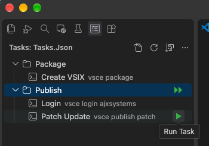
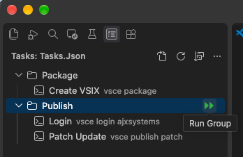

# AJxVSCA Tasks

AJxVSCA Tasks is a Visual Studio Code extension that adds a sidebar for browsing and running tasks defined in your workspace's `.vscode/tasks.json` or a shared task file elsewhere on your system.

Run a task with one click, or run every task in a group in sequence:

<table>
  <tr>
    <td align="center"><strong>Run a task</strong><br></td>
    <td align="center"><strong>Run a group</strong><br></td>
  </tr>
</table>

## Features

- Lists workspace tasks and lets you sort them by name or by their order in the workspace task list.
- Groups tasks whose labels use the `Group: Task` format. For example, `Build: Api` appears as `Api` under `Build`.
- Shows tasks without a colon at the top level.
- Shows each task's command in lighter secondary text next to its name and the full command on hover.
- Runs a task from its inline play button.
- Runs all tasks in a group, in order, from the group's inline play button after confirmation.
- Opens `.vscode/tasks.json` from the Tasks view title bar, prompting to create it if it does not exist.
- Loads a shared `tasks.json` from anywhere on the system, with a button to return to workspace tasks.
- Refreshes the task list when the active task file is created, changed, or deleted, or when you select the refresh button.
- Includes a collapsed **How to use** view with a brief `tasks.json` reference.

By default, only tasks scoped to a workspace are shown; user-level tasks are excluded.

## Shared command libraries

The sidebar has separate **Task Libraries** and **Commands** panels. Select **Load Shared tasks.json**
(folder icon) in the Task Libraries title bar and choose one or more task files.
Each file is validated before it is added. Unreadable, malformed, or unsupported task files are skipped
with an error showing the file path and reason. Valid files are saved together; the first valid file in
the selection becomes active. If none are valid, the current source and saved list stay unchanged.
Files are never executed during validation. Select another saved file to switch lists; files are not merged.
The shared file replaces the workspace task list; it is not copied into your project or modified.
Each successfully loaded file is saved once per workspace in **Task Libraries**.
Click a file to show its tasks in **Commands** without reopening the file picker.
Selecting a shared file or **Workspace tasks** automatically opens and focuses **Commands**, while
**Task Libraries** remains visible.
Entries show the filename and up to three parent folders, with the full path on hover. The active file has a blue check icon;
native tree labels use VS Code's normal text color. Saved files stay available after
returning to workspace tasks and after reopening VS Code. Missing or invalid selections report an error
and leave the current task source unchanged. **Open tasks.json** opens the active file for editing.
Use a saved file's **x** button to remove it from the library list without deleting the file on disk.
Removing the active file returns to workspace tasks. You can add a removed file again with the file picker.
**Task Libraries** has a **Load Shared tasks.json** button that keeps its normal color in all modes.
**Commands** has **Open tasks.json** / **Refresh Tasks** / **Sort Tasks** buttons and shows the active
task filename beside its title (`tasks.json` for workspace tasks).
Select the **Workspace tasks** row at the top of **Task Libraries** to switch back to the project.
**Open tasks.json** opens the active file, and **Refresh Tasks** reloads it.
Changes, deletion, and recreation of the shared file also refresh the list automatically.
A missing or invalid shared file shows an error instead of silently falling back to workspace tasks.

Shared files use version `2.0.0` and support JSON comments and trailing commas, `shell` and `process` tasks,
arguments (including shell quoting), platform overrides, global defaults, working-directory/environment options,
named problem matchers (a string or array of strings), presentation options, build/test groups,
and `dependsOn` labels within the same file.
Dependencies follow `dependsOrder` (`parallel` by default or `sequence`); missing or circular dependencies are rejected.
Compound tasks with dependencies and no command are also supported.
Dependencies shared by multiple branches run once per task invocation. Group runs remain sequential, and each
group task runs its own dependencies, so a dependency can run again for another group task.

Commands run in the first workspace folder by default, not beside the shared file. With no workspace open,
they run beside the shared file. Set `options.cwd` explicitly when needed.
VS Code resolves execution variables such as `${workspaceFolder}` and `${env:NAME}` in the task's execution context.
Workspace folder variables require an open workspace.
Shared files do not support extension-provided task types (such as `npm` or `dotnet`), `inputs`/`${input:...}`,
dependency objects, or automatic `runOn` execution. `group.isDefault` does not change VS Code's default
build/test shortcuts. Use equivalent shell/process commands instead of extension-provided task types.
Background tasks used as dependencies are awaited until they finish; readiness-based background dependencies
are not supported. Only load and run shared commands from files you trust.

## Getting started

1. Open a folder or workspace in VS Code.
2. Add tasks to `.vscode/tasks.json`. For example:

   ```json
   {
     "version": "2.0.0",
     "tasks": [
       {
         "label": "Build: Api",
         "type": "shell",
         "command": "dotnet",
         "args": ["build"]
       },
       {
         "label": "Test: Api",
         "type": "shell",
         "command": "dotnet",
         "args": ["test"]
       },
       {
         "label": "List files",
         "type": "shell",
         "command": "ls"
       }
     ]
   }
   ```

3. Open the **Tasks** activity bar view. Use its **Open tasks.json** title bar button to open the workspace task file, or select a task's play button to run it in the VS Code task terminal. To run a whole group, select the group's play button and confirm; tasks run sequentially in the selected sort order.

The example tasks use `dotnet` and `ls`; replace commands and arguments with ones available in your environment. VS Code must be version 1.80 or later.

## Sorting tasks

By default, tasks are sorted by name. To change this, select the **Sort Tasks** button (sort icon) in the Tasks view title bar, next to **Refresh**, and pick an option:

| Option | Result |
| --- | --- |
| **Name (A-Z)** (default) | Groups are sorted alphabetically, followed by ungrouped tasks. Tasks within each group are sorted by name. |
| **File order** | Tasks and groups follow the order of the workspace task list, so you control the order by arranging tasks in `tasks.json`. A group appears where its first task occurs, and tasks within a group keep their order. |

How it works:

- The picker shows the current option in its placeholder text. The list updates as soon as you choose.
- Your choice is remembered for each workspace, so it is restored the next time you open it.
- Group play buttons run tasks in the order currently shown, so the sort option also controls the run order.
- For workspace tasks, file order is the order in which VS Code returns tasks, which normally matches their order in `.vscode/tasks.json`. For a shared library, it is the exact order of the file's `tasks` array.

**Tip:** When sorting by name, numbers are sorted numerically, so `2` comes before `10`. Zero-padding is optional; use it only if you prefer labels such as `02. Build` and `10. Deploy` to have consistent-width numbering.

## License

This project is licensed under the MIT License. See [LICENSE](./LICENSE).
