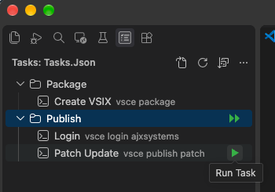
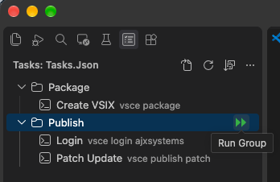

# AJxVSCA Tasks

AJxVSCA Tasks is a Visual Studio Code extension that adds a sidebar for browsing and running tasks defined in your workspace's `.vscode/tasks.json`.

Run a task with one click, or run every task in a group in sequence:

<table>
  <tr>
    <td align="center"><strong>Run a task</strong><br></td>
    <td align="center"><strong>Run a group</strong><br></td>
  </tr>
</table>

## Features

- Lists workspace tasks and lets you sort them by name or by their order in the workspace task list.
- Groups tasks whose labels use the `Group: Task` format. For example, `Build: Api` appears as `Api` under `Build`.
- Shows tasks without a colon at the top level.
- Shows each task's command in lighter secondary text next to its name and the full command on hover.
- Runs a task from its inline play button.
- Runs all tasks in a group, in order, from the group's inline play button after confirmation.
- Opens `.vscode/tasks.json` from the Tasks view title bar.
- Refreshes the task list when `.vscode/tasks.json` is created, changed, or deleted, or when you select the refresh button.
- Includes a collapsed **How to use** view with a brief `tasks.json` reference.

Only tasks scoped to a workspace are shown; user-level tasks are excluded.

## Getting started

1. Open a folder or workspace in VS Code.
2. Add tasks to `.vscode/tasks.json`. For example:

   ```json
   {
     "version": "2.0.0",
     "tasks": [
       {
         "label": "Build: Api",
         "type": "shell",
         "command": "dotnet",
         "args": ["build"]
       },
       {
         "label": "Test: Api",
         "type": "shell",
         "command": "dotnet",
         "args": ["test"]
       },
       {
         "label": "List files",
         "type": "shell",
         "command": "ls"
       }
     ]
   }
   ```

3. Open the **Tasks** activity bar view. Use its **Open tasks.json** title bar button to open the workspace task file, or select a task's play button to run it in the VS Code task terminal. To run a whole group, select the group's play button and confirm; tasks run sequentially in the selected sort order.

The example tasks use `dotnet` and `ls`; replace commands and arguments with ones available in your environment. VS Code must be version 1.80 or later.

## Sorting tasks

By default, tasks are sorted by name. To change this, select the **Sort Tasks** button (sort icon) in the Tasks view title bar, next to **Refresh**, and pick an option:

| Option | Result |
| --- | --- |
| **Name (A-Z)** (default) | Groups are sorted alphabetically, followed by ungrouped tasks. Tasks within each group are sorted by name. |
| **File order** | Tasks and groups follow the order of the workspace task list, so you control the order by arranging tasks in `tasks.json`. A group appears where its first task occurs, and tasks within a group keep their order. |

How it works:

- The picker shows the current option in its placeholder text. The list updates as soon as you choose.
- Your choice is remembered for each workspace, so it is restored the next time you open it.
- Group play buttons run tasks in the order currently shown, so the sort option also controls the run order.
- File order is the order in which VS Code returns the workspace tasks, which normally matches their order in `.vscode/tasks.json`.

**Tip:** When sorting by name, numbers are sorted numerically, so `2` comes before `10`. Zero-padding is optional; use it only if you prefer labels such as `02. Build` and `10. Deploy` to have consistent-width numbering.

## License

This project is licensed under the MIT License. See [LICENSE](./LICENSE).
